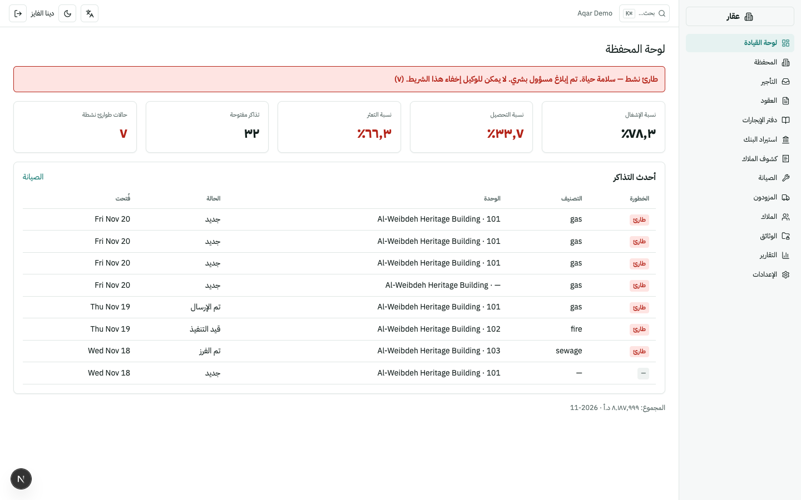
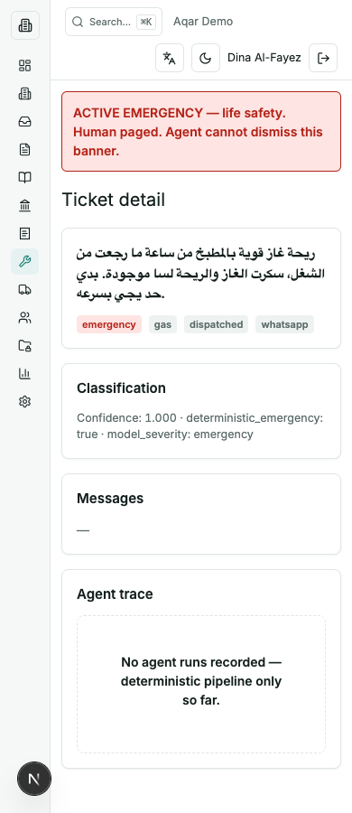

# Aqar — عقار

Open-source **property operations ledger with an agentic maintenance layer**,
Jordan/MENA-first. A money-and-obligation ledger with an operations queue
attached — not a CRM, not a listings site.

**Three laws:** money is deterministic (pure integer-fils core, zero I/O) ·
life safety is a hard code branch (deterministic emergency pre-check a model
can never suppress) · every action is attributed and reversible (append-only
audit, one-click undo).

## Quickstart
```bash
cp .env.example .env
docker compose -f infra/docker-compose.yml up -d
pnpm install && pnpm db:migrate && pnpm db:seed
pnpm dev                              # web console :3000
pnpm --filter @aqar/worker dev        # triage consumer (BullMQ)
pnpm --filter @aqar/channels dev      # webhook ingress :8787
pnpm test                             # all suites (real PG/Redis/Mailpit)
pnpm --filter @aqar/worker e2e        # live ticket→triage→proposals proof
pnpm --filter @aqar/evals evals       # LAW-2 recall gate (deterministic)
```
Dev login: `admin@aqar.example` / `aqar-dev-admin-123`. Arabic-first RTL UI
with one-click English LTR; JOD rendered with 3 decimals everywhere.

## Status
Built and verified: pure money/ops core (361 tests incl. property + LAW-2
adversarial), Drizzle schema with up/down migrations + RLS + append-only
guards (9 integration tests on real Postgres), bilingual AR/EN RTL console
(auth, dashboard, ledger, tickets + agent trace), typed agent layer with a
live local-model smoke, BullMQ worker + webhook channels (34 tests incl.
live signature/idempotency/Mailpit proofs), and a bilingual evals harness
(recall 1.0000, FP 0.00% in both deterministic and live-model lanes).
The real queue path is proven end-to-end: an Arabic gas-leak ticket keeps
its emergency flag even when the model under-calls it, and every proposed
action stays dry_run until a human approves.

Not built yet (listed, never implied): bank-import wizard, owner-statement
screen, Playwright e2e, a11y CI job, perf budgets, NL query. See
`BLOCKERS.md` for the exact resume point and `docs/` for architecture,
domain invariants, decisions, runbook and security model.

## Screenshots
`docs/screenshots/` — dashboard, ledger, emergency ticket detail, the
bank-import wizard and the owner statement, in Arabic (RTL) and English
(LTR) at 1440 / 1024 / 768 / 390 px, captured at true layout widths and
verified overflow-free.




## Licence
MIT. Reference-project pattern attributions in `docs/DECISIONS.md`.
